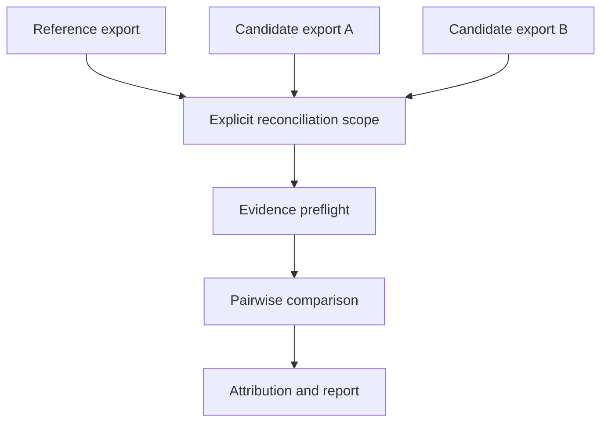
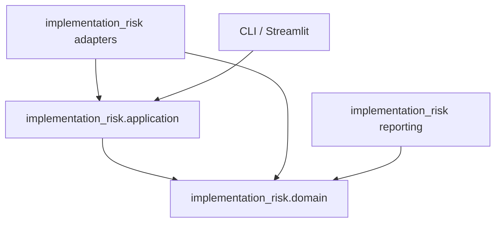
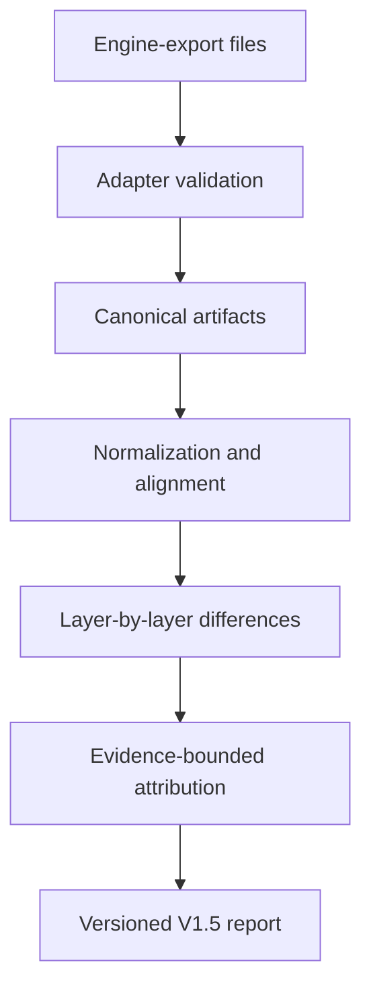

# V1.5A Implementation-Risk Architecture

Status: accepted foundation introduced in package `1.5.0a1`; Part B contracts
are documented in [`V1_5B_CANONICAL_CONTRACTS.md`](V1_5B_CANONICAL_CONTRACTS.md).

V1.5 asks a different question from V1:

- V1 asks whether statistical claims from a backtest deserve confidence.
- V1.5 asks whether implementations of the same intended strategy produce
  materially different results, and which implementation layer first diverges.

V1.5 does **not** declare one engine correct. Agreement can be wrong, and
disagreement only proves that implementation choices matter. A reference run
is a comparison baseline, not ground truth.

## Accepted operating model

V1.5 remains a file-first, read-only capability inside the existing modular
monolith. It consumes exported evidence from backtesting engines. It does not:

- import or execute an engine as part of an audit;
- submit, cancel, or modify an order;
- connect to a broker for execution;
- reconstruct real broker trading, which belongs to V4;
- select the best strategy or optimize parameters;
- silently align, resample, aggregate, or repair evidence;
- certify that matching implementations are economically valid.

Keeping engine execution outside the auditor avoids environment coupling and
makes the supplied evidence reproducible. A later convenience runner may be a
separate adapter, but it must export the same contracts and cannot become the
domain model.

## Comparison topology

One explicitly declared reference run is compared independently with one or
more candidate runs. This avoids an unnecessary all-pairs matrix and gives
every difference a stable direction. The reference can be:

- a trusted internal implementation;
- a previous version of the same engine;
- a simple hand-checkable implementation;
- merely the run chosen as the reporting baseline.

The reference label never means “correct.” Comparing versions of the same
engine is valid; different engine names are not required.

## Independent comparison levels

Availability is assessed separately at every requested level. Later outputs
do not prove that upstream layers matched. Equal returns do not prove equal
orders; unequal returns cannot be attributed to fills if fill evidence is
missing.

| Canonical level | What it will compare | What it cannot establish alone |
|---|---|---|
| `strategy_specification` | Normalized strategy rules and declared assumptions | That engine code implements the declaration |
| `market_data` | Input observations and data identity | That the vendor data are economically correct |
| `signal` | Timestamped intended decisions or target states | That orders were generated or filled identically |
| `order` | Submitted simulated order intent | Execution-price or cost equivalence |
| `fill` | Simulated executions and partial fills | Correct position or cash accounting |
| `trade` | Engine-declared or canonically reconstructed trade groupings | Fill-level equality when fills are absent |
| `position` | Timestamped quantities and inventory state | Cash or cost equality |
| `cash` | Cash balances and cash movements | Position valuation correctness |
| `cost` | Commissions, fees, spread/slippage and other declared costs | That an omitted cost was zero |
| `equity` | Portfolio-value path | Equal implementation mechanics |
| `return` | Period return path and compounding basis | Equal equity, cash, or fill mechanics |

The enum definition order is the canonical reporting order. A caller may
request any non-empty subset, but duplicate requests are rejected rather than
silently deduplicated.

## V1.5A domain contracts

`EngineRunReference`
: Identifies a run, engine, optional engine version, and SHA-256 identity of
  the exported source bundle. An adapter calculates the digest; users do not
  need to calculate it manually. A missing engine version remains `None` and
  is never replaced with a guess.

`ReconciliationScope`
: Declares a reconciliation ID, one reference run, one or more unique
  candidate runs, and explicit requested comparison levels.

`RunEvidenceProfile`
: Declares which requested or unrequested evidence levels an adapter can
  substantiate for one run. An empty profile is valid and visible.

`ScopeAssessment`
: Records pairwise, level-specific eligibility before any numerical comparison
  begins. It distinguishes reference missing, candidate missing, both missing,
  and eligible.

## Preflight semantics

Every scoped run must have exactly one evidence profile. Missing evidence
*levels* are normal typed outcomes. Missing, duplicate, extra, or
identity-mismatched *profiles* are contract failures because they could cause
the system to assess a different set of runs than the declared scope.

For one level and one reference/candidate pair:

| Reference has level | Candidate has level | Status |
|---|---|---|
| Yes | Yes | `eligible` |
| Yes | No | `candidate_unavailable` |
| No | Yes | `reference_unavailable` |
| No | No | `both_unavailable` |

No unavailable level blocks an independently eligible level. This preserves
partial evidence while preventing invented attribution.

## Frozen V1.5 invariants

1. The system compares exported evidence and never executes a backtest.
2. Reference and candidate run IDs are unique within a scope.
3. Every source bundle has an adapter-computed SHA-256 identity.
4. Engine version may be unknown; it is never inferred.
5. Requested levels are explicit, non-empty, unique, and canonically ordered.
6. Evidence availability is independent across levels.
7. A reference run is not labeled correct or authoritative by the domain.
8. Timestamps are never silently shifted, rounded, joined, or resampled.
9. Missing evidence produces a typed unavailable result, not a fabricated zero.
10. Reconciliation identifies divergence; it does not certify strategy skill,
    profitability, market-data correctness, or future performance.
11. V1 report schema `2.5`, manifest schema `1.1`, and all V1 statistical
    semantics remain frozen during V1.5.
12. Domain code depends only on the Python standard library and cannot import
    pandas, an engine SDK, persistence, CLI, Streamlit, or reporting code.

## Bounded capability and dependency direction

V1.5 is implemented as `backtest_auditor.implementation_risk`, a capability
boundary rather than an expansion of V1's return-series domain.

Part A creates only the domain package because it has immediate preflight
behavior. Application, adapter, and reporting packages are created only when
their working implementations arrive. Empty future modules are prohibited.

The V1 statistics, audit, ingestion, persistence, and reporting packages remain
unchanged. Later integration may pass a reconciled return series to V1 through
an explicit application service; V1.5 statistics must not be inserted into V1
report schema `2.5` informally.

## Planned data flow after later parts

Each adapter is an anti-corruption layer. Engine-specific column names,
timestamp conventions, order statuses, trade groupings, and accounting rules
must terminate at the adapter boundary. Comparison services consume canonical
objects only.

## Reconciliation versus attribution

V1.5 must keep two claims separate:

1. **Observed divergence:** a canonical value differs beyond an explicit
   tolerance.
2. **Attributed cause:** an earlier evidence layer explains a later
   divergence.

The first can be reported whenever both artifacts are comparable. The second
requires the relevant upstream evidence and a documented causal rule. If two
equity curves differ but fills are unavailable, the report may state an equity
divergence; it may not call it fill-model divergence.

## Provenance and SHA-256

The source digest answers “which exact exported bytes were assessed?” It is not
a digital signature and does not prove that the export is truthful. It prevents
two different files with the same filename or run ID from being silently
treated as the same evidence. Adapters calculate it automatically and later
manifests will bind it to canonical artifact hashes and configuration.

## Decisions deferred deliberately

Parts A and B do not choose or implement concrete engines. The canonical
strategy and execution-artifact contracts were frozen in Part B. The following
remain deferred:

- timestamp and session alignment rules;
- numeric, quantity, price, or currency tolerances;
- trade reconstruction policy;
- root-cause taxonomy and materiality policy;
- implementation-uncertainty report schema;
- CLI or Streamlit workflows.

Freezing those before working canonical artifacts exist would create
speculative abstractions. They belong to Parts B–I and require explicit tests.

## Completed V1.5 increments

| Increment | Responsibility |
|---|---|
| B | Canonical strategy and execution-artifact contracts — completed in `1.5.0a2` |
| C | Adapter port, validation failures, and generic file contract — completed in `1.5.0a3` |
| D1 | Shared five-engine adapter foundation — completed in `1.5.0a4` |
| D2 | vectorbt, bt, and Backtrader concrete adapters — completed in `1.5.0a5` |
| D3 | QuantConnect LEAN and NautilusTrader adapters plus complete-roadmap conformance hardening — completed in `1.5.0a6` |
| E | Identity, timestamp, symbol, currency, and frequency normalization — completed in `1.5.0a7` |
| F | Deterministic layer-by-layer alignment and comparison — completed in `1.5.0a8` |
| G | Cost, sizing, return, and accounting divergence analysis — completed in `1.5.0a9` |
| H | Evidence-bounded attribution, materiality, and uncertainty findings — completed in `1.5.0a10` |
| I | Versioned reports, CLI, Streamlit, schema, and manifest integration — completed in `1.5.0a11` |
| J | Golden data, reference cases, property tests, performance, and release hardening — completed in `1.5.0` |

Concrete engine selection is required before Part D, not before the
engine-neutral Parts A–C.

## V1.5A definition of done

- The implementation-risk capability boundary exists without empty future
  packages.
- Run identity and source provenance are immutable and validated.
- Reference-to-candidates scope is explicit and deterministic.
- Eleven comparison levels have stable names and canonical order.
- Evidence availability is assessed independently with four typed statuses.
- Invalid scope/profile collections fail rather than being repaired.
- Architecture, boundaries, invariants, deferred decisions, and roadmap are
  documented.
- The new code passes formatting, lint, focused static typing, coverage, build,
  installation, and the full V1.4 regression suite.
