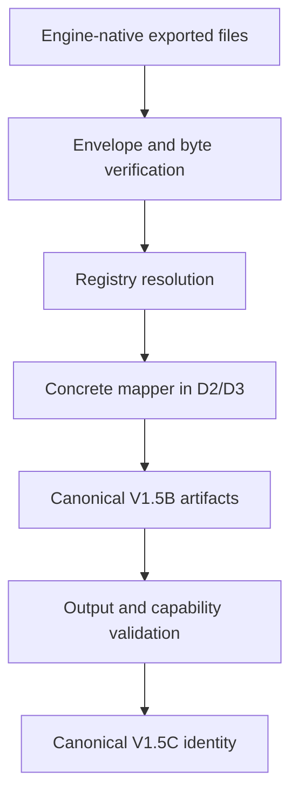

# V1.5D1 Shared Engine-Adapter Foundation

Status: implemented in package `1.5.0a4`.

V1.5D1 establishes the one boundary that every selected backtesting engine
must cross. It intentionally implements no vectorbt, bt, Backtrader, LEAN, or
NautilusTrader column mapping yet. Those mappings belong to D2 and D3.

## Accepted engine roadmap

The order is part of the public implementation plan:

1. `vectorbt`
2. `bt`
3. `backtrader`
4. `quantconnect_lean`
5. `nautilustrader`

The first three concrete mappers are D2. QuantConnect LEAN and
NautilusTrader, followed by cross-adapter conformance hardening, are D3.
Adding a name to this enum does not claim that an adapter exists. Only a
registered mapper with a complete descriptor is executable by the import
service.

## Why D1 is separate

The engines expose materially different concepts. A shared boundary must
prevent each adapter from inventing its own answer to these questions:

- Which exact source bytes were normalized?
- Which engine and export-contract versions were accepted?
- Which of the eleven evidence levels can the adapter substantiate?
- Is a missing level unavailable, or available but empty?
- Which limitations are non-fatal warnings, and which failures invalidate the
  entire import?
- Does normalized output still refer to the same run and source export?

Freezing these rules before concrete mappings reduces the chance that the first
implemented engine silently becomes the de facto domain model.

## Data flow

No step executes a backtest or imports an engine SDK. Exporter helpers may run
inside an engine's own environment later, but the auditor only receives files.

## Common engine-export envelope

Every source is a suffix-free directory or `.zip` containing
`engine-export.json` and one or more payload files. The envelope schema is
`1.0` and contains exactly:

- run ID;
- one of the five canonical engine IDs;
- explicit engine version or `null`;
- export-format ID and version;
- canonically ordered declared evidence levels;
- a canonically ordered payload inventory with path, semantic role, media
  type, byte size, and SHA-256;
- `source_sha256`, the identity of the canonical envelope body and file
  inventory.

`source_sha256` is calculated automatically. It binds metadata and each
payload digest, so changing a payload, role, engine version, run ID, or declared
level changes source identity. It remains a content identity, not a digital
signature and not proof that the source engine reported truthfully.

The committed `examples/v1_5d1_engine_export` directory illustrates this
transport only. Its vectorbt label does not constitute a vectorbt mapper; that
arrives in D2.

## File safety and reproducibility

The shared file adapter:

- supports the same semantics in directory and ZIP form;
- produces deterministic ZIP entry order, timestamps, permissions, and bytes;
- rejects symbolic links, traversal paths, absolute paths, duplicate archive
  entries, encrypted entries, unsupported compression, missing or undeclared
  payloads, and malformed/noncanonical JSON;
- validates declared size and SHA-256 before a mapper sees payload bytes;
- enforces explicit file-count, per-file, manifest, and total-size bounds;
- loads immutable verified bytes, avoiding a verify-then-reread race;
- protects existing destinations unless `overwrite=True` is explicit;
- uses temporary output and atomic publication, with rollback for replaced
  directories.

Nested relative payload paths are allowed because advanced engines may export
several related tables. Paths use canonical POSIX separators regardless of the
host operating system.

## Capability declarations

Every mapper descriptor must declare all eleven comparison levels exactly once
and in canonical order. Each level has two independent attributes:

| Attribute | Values | Meaning |
|---|---|---|
| Availability | `always`, `conditional`, `unsupported` | Whether the mapper promises the level for every export, only some exports, or never |
| Origin | `engine_export`, `deterministic_derivation`, `none` | Whether evidence is directly exported, derived by a documented deterministic rule, or unavailable |

An unsupported capability must use origin `none`. A supported capability
cannot use `none`. Each declaration includes a non-empty explanation. This
prevents a capability matrix from becoming a list of undocumented booleans.

Static capability and actual evidence are separate:

- The descriptor states what the mapper can support.
- `declared_levels` states what this particular export claims to contain.
- `CanonicalRunArtifacts.available_levels` states what the mapper actually
  emitted.

The import succeeds only when actual and declared levels match exactly.
`always` levels must be present, and `unsupported` levels must be absent.
Within an available canonical level, an empty tuple still means
available-but-empty; `None` remains unavailable.

## Exact version policy

An adapter descriptor declares:

- adapter ID and version;
- engine ID and display name;
- one export-format ID;
- an exact set of supported export-format versions;
- an exact set of tested engine versions;
- explicit booleans controlling undisclosed or untested engine versions.

Export-format versions are always fail-closed. An unlisted format version is
rejected because its columns or semantics may have changed. Engine versions
are exact strings rather than guessed semantic-version ranges: many engines
use ecosystem-specific version syntax, and an apparently small update can
change execution behavior. A future adapter may explicitly accept an
undisclosed or untested engine version, but that policy must be visible in its
descriptor rather than silently assumed.

## Registry rules

The registry is keyed by `(engine, export_format_id)`. It requires:

- runtime conformance to the `EngineArtifactMapper` port;
- a valid immutable descriptor;
- unique adapter IDs;
- one unambiguous mapper per engine/export-format route;
- deterministic descriptor order based on the accepted engine roadmap.

The project does not use import-time global registration. Callers construct a
registry explicitly, making tests, installed behavior, and dependency wiring
reproducible.

## Fatal failures versus warnings

Fatal failures raise `EngineAdapterError` with a stable
`EngineAdapterErrorCode`. Context can include engine, adapter ID,
engine-specific detail code, file, row, and field. Fatal categories cover
source safety, envelope integrity, provenance, unsupported versions, registry
resolution, mapping failure, capability contradiction, and output-contract
failure.

Successful imports may retain canonically ordered `AdapterWarning` objects.
A warning has a stable code, message, and optional verified file/row/field
reference. A warning file path must reference a payload whose bytes were
verified. Warnings cannot make a failed or ambiguous import appear successful;
a contradiction in identity, version, capability, or canonical domain rules is
fatal.

Concrete mapper failures in D2/D3 should raise the common error with a namespaced
engine detail such as `vectorbt.missing_column`. If a mapper leaks an arbitrary
exception, the service converts it to a generic typed `mapping_failed` error
while retaining the original exception as the Python cause.

## Output invariants

Before returning `EngineAdapterResult`, the service proves:

1. Run ID equals the verified envelope run ID.
2. Canonical engine name equals the stable engine ID.
3. Engine version equals the explicit envelope value, including `None`.
4. Canonical source SHA-256 equals the verified export identity.
5. Actual available levels equal declared levels exactly.
6. Static always/unsupported capability promises are honored.
7. Warning file references point only to verified payloads.
8. The canonical V1.5C bundle can be serialized deterministically and assigned
   `canonical_bundle_sha256` without writing a file.

The result retains both raw-source and normalized-canonical identities. This
distinguishes “same export, same normalization” from “same run label, different
bytes” and makes later reconciliation manifests reproducible.

## Public ports

`EngineExportReader`
: Verifies and loads the common envelope and immutable source payloads.

`EngineArtifactMapper`
: Exposes one descriptor and maps `VerifiedEngineExport` to
  `EngineMappingOutput`.

`CanonicalArtifactBundleIdentity`
: Calculates the deterministic V1.5C normalized-bundle SHA-256 without file
  output.

`EngineAdapterRegistry`
: Resolves one mapper deterministically from verified engine and format
  identity.

`EngineAdapterService`
: Orchestrates verify, resolve, version check, map, capability check, output
  check, and normalized identity.

## Compatibility and exclusions

V1.5D1 advances only the package prerelease to `1.5.0a4`. It does not change:

- V1 report schema `2.5`;
- V1 audit-manifest schema `1.1`;
- database schema `1`;
- canonical artifact schema `1.0`;
- canonical bundle schema `1.0`;
- canonical run-specification schema `1.0`;
- any V1 statistical calculation, CLI, Streamlit, or persistence behavior.

D1 also adds no concrete engine parsing, timestamp/symbol normalization,
alignment tolerance, comparison, attribution, implementation-risk report,
engine execution, broker integration, or live trading.

## D1 definition of done

- The five-engine roadmap and order are explicit.
- Every future mapper has one runtime-checkable port and descriptor contract.
- Every descriptor declares all eleven capability levels.
- Raw exports have a strict versioned envelope and verified byte provenance.
- Directory and deterministic ZIP transports round-trip identically.
- Registry resolution is explicit and unambiguous.
- Engine/export versions fail closed under declared policy.
- Fatal failures and retained warnings are separate typed objects.
- Mapping output is revalidated against identity, declared levels, and static
  capabilities.
- Canonical output receives a deterministic normalized SHA-256.
- The package remains free of vectorbt, bt, Backtrader, LEAN, and
  NautilusTrader runtime dependencies.
