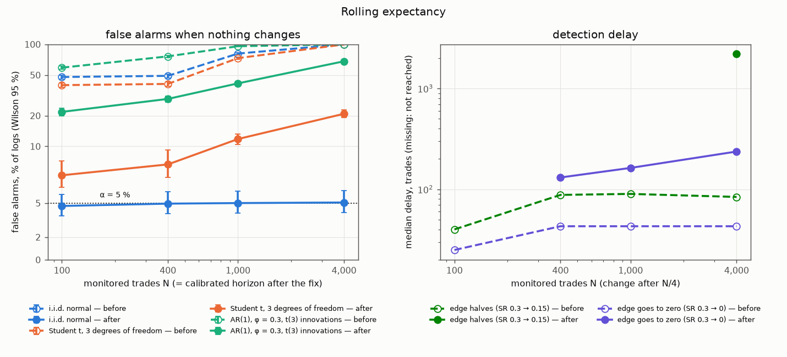
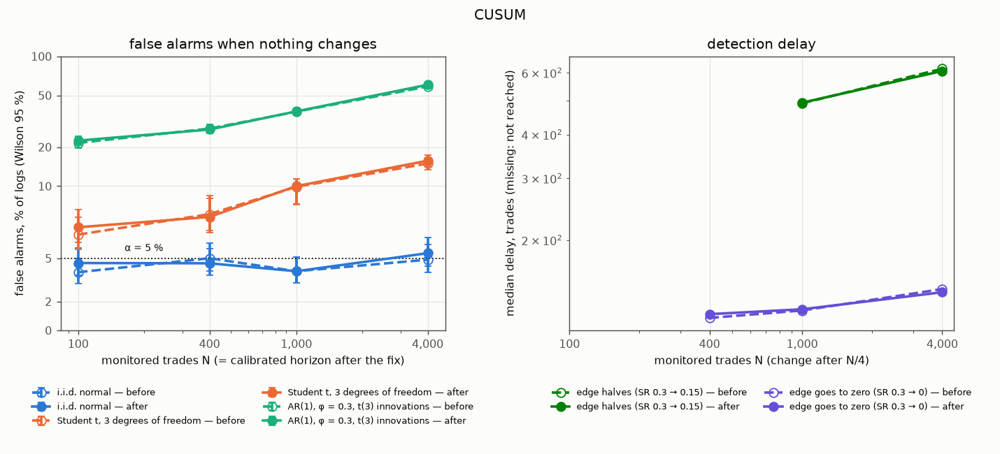
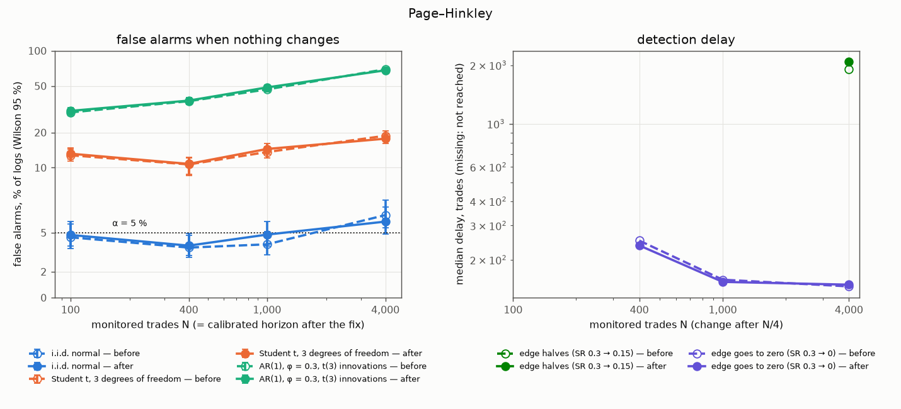
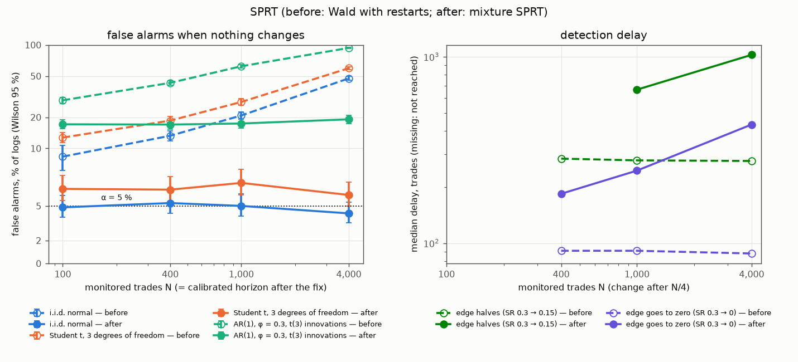

# Edge Audit decay detectors — calibration (version 1.1)

What this file answers: how often each decay detector raises an alarm when nothing has
changed, how fast it alarms when the edge halves or disappears, why version 1.0's sequential
test alarmed far more often than its 1 % design level, and what version 1.1 changed. Every
number below is a cell of `calibration/results_before.json` or `calibration/results_after.json`
(written by `calibration/evaluate_detectors.py`); the tables are generated from them and a
test (`tests/edge_audit/test_edge_audit_calibration_doc.py`) requires this file to contain
them verbatim.

## 1. Summary

* **Under the calibration null (i.i.d. normal trades) every 1.1 detector holds its budget.**
  With α = 5 % and the horizon set to the monitored trades, the four detectors raise a false
  alarm in 4.0–5.9 % of no-change logs at N = 100, 400, 1,000 and 4,000 (Table A,
  2,000 logs per cell). The ±1.5-point tests at N = 400 and 1,000 on 4,000 fresh logs per cell:
  N = 400: rolling expectancy 4.95 %, CUSUM 5.08 %, Page–Hinkley 5.45 %, mixture SPRT 5.15 %; N = 1,000: rolling expectancy 4.52 %, CUSUM 4.20 %, Page–Hinkley 5.42 %, mixture SPRT 4.05 % — all inside 3.5–6.5 % (`job_calibration/evidence/detector_calibration.json`).
* **The SPRT.** J9's Wald SPRT alarmed in 9.3, 13.2, 20.8 and 47.5 % of no-change logs at
  N = 100 to 4,000. It is replaced by a mixture SPRT with simulated thresholds: 4.9, 5.2, 5.0
  and 4.3 %. The causes, tested in Table C: restarting without a horizon (with μ₀ and σ₀ known
  the restarts alone give 46.2 % at N = 4,000) and the estimated reference (one cycle: 4.5 %
  instead of 0.7 % at N = 100). The simple-versus-composite alternative is not a cause of false
  alarms.
* **The rolling expectancy.** J9 reported the series without an alarm; read as "the average of
  the last w trades fell below zero" it flags 47.8–100.0 % of healthy logs. The calibrated
  rolling-expectancy alarm: 4.7–5.1 %.
* **CUSUM and Page–Hinkley** were already simulated inside every J9 audit and were close to
  5 % before (3.9–6.3 %); they now read the table, state their horizon and null, and stay at
  4.0–5.9 %.
* **The price.** Calibrated detectors alarm later than miscalibrated ones: when the edge goes to
  zero after N/4 trades, the SPRT's median delay at N = 400 is 184 trades instead of 91 (Table B).
  CUSUM is the fastest calibrated detector for a full loss (median 123, 127 and 142 trades at
  N = 400, 1,000 and 4,000). A halving (SR 0.3 → 0.15) is slow for every detector: at N = 400
  none reaches a median within the 300 trades after the change; at N = 1,000 CUSUM's median is
  493 trades and the mixture SPRT's 666.
* **Not fixed: fat tails and serial dependence.** The table assumes i.i.d. normal trades. Under
  Student t(3) the calibrated detectors alarm in 5.9–20.8 % of no-change logs, under AR(1)
  φ = 0.3 in 17.0–68.2 % (Table A); the mixture SPRT is the least affected (5.9–7.0 % and
  17.0–19.1 %). The report names the null each threshold assumes and warns when the trades are
  serially dependent.

## 2. What was simulated

* **Logs.** Per-trade P&L with a constant edge of SR 0.3 per trade (J9's scenario (c) value).
  The audit's default geometry: R = N/2 reference trades, then N monitored trades (the
  default reference max(30, ⌊T/3⌋) with T = 1.5 N), N = 100, 400, 1,000 and 4,000. 2,000 logs
  per cell; the same logs (same seeds) for the before and the after column.
* **Nulls (nothing changes).** `iid_normal`; `student_t3` (Student t, 3 degrees of freedom,
  scaled to unit variance); `ar1_t3` (AR(1), φ = 0.3, the same t(3) shocks, unit marginal
  variance, 200-step burn-in). A false alarm is any alarm within the N monitored trades.
  Brackets: Wilson 95 % intervals.
* **Changes (normal noise).** After the first N/4 monitored trades the edge halves
  (SR 0.3 → 0.15) or goes to zero. Delay = alarm trade − change trade, over logs without an
  earlier alarm; a log without an alarm by trade N counts as an infinite delay, so a median
  or 90th percentile can be "not reached". "Early" = alarm before the change.
* **Before** = J9's code as shipped in 1c1184a (frozen copy `calibration/j9_decay.py`), run
  with the audit's defaults:
  * rolling expectancy: J9 reports the series but raises no alarm. The column measures the
    reading the report invites: an alarm when the average of the last w trades (J9's default
    w) is below zero;
  * CUSUM and Page–Hinkley: thresholds simulated inside every audit (2,000 i.i.d. normal draws
    with the reference re-estimated, horizon = the monitored trades). The harness caches J9's
    draws per (R, M) — J9 draws the same ones for every log — and checks that the cached
    thresholds equal J9's own function bit for bit (`cached_threshold_check` in
    `results_before.json`);
  * SPRT: Wald's test of "edge gone" (δ = SR₀) with α = 0.01, β = 0.10, restarted after every
    "intact" decision.
* **After** = this package (`analyse_decay`, the code the audit runs) with α = 5 % and the
  horizon set to N: thresholds from the table (`decay_thresholds.py`), the rolling-expectancy
  alarm, CUSUM, Page–Hinkley and the mixture SPRT that replaces Wald's SPRT.

J9 reported the SPRT at 18.5 % over 400 monitored trades. That was 37 of 200 control logs
(Wilson 95 % 13.7–24.5 %); the harness reproduces exactly those counts on J9's own control
seeds (`calibration/j9_control_check.txt`: CUSUM 15, Page–Hinkley 7, SPRT 37 of 200). On the
2,000 fresh logs below the same code alarms in 13.2 % (Wilson 11.8–14.8 %) of no-change logs: J9's
200-log sample ran high, and the rate is still far above 1 %.

### Table A — false alarms before and after

**False alarms, i.i.d. normal (the calibration null)** — share of logs with any alarm within the N monitored trades, Wilson 95 % interval in brackets.

| Detector | N = 100 | N = 400 | N = 1,000 | N = 4,000 |
|---|---|---|---|---|
| Rolling expectancy — before: average of the last w trades < 0 (J9's series read literally) | 47.8 % (45.6–50.0) | 49.0 % (46.9–51.2) | 81.1 % (79.3–82.8) | 100.0 % (99.7–100.0) |
| Rolling expectancy — after: rolling-expectancy alarm, table threshold | 4.7 % (3.9–5.8) | 5.0 % (4.1–6.0) | 5.0 % (4.1–6.0) | 5.1 % (4.2–6.1) |
| CUSUM — before: J9, threshold simulated per audit (2,000 draws) | 4.0 % (3.2–5.0) | 5.0 % (4.1–6.0) | 4.1 % (3.3–5.1) | 4.9 % (4.0–5.9) |
| CUSUM — after: table threshold | 4.7 % (3.8–5.7) | 4.7 % (3.8–5.7) | 4.1 % (3.3–5.1) | 5.3 % (4.4–6.4) |
| Page–Hinkley — before: J9, threshold simulated per audit (2,000 draws) | 4.6 % (3.8–5.7) | 3.9 % (3.1–4.8) | 4.1 % (3.3–5.1) | 6.3 % (5.4–7.5) |
| Page–Hinkley — after: table threshold | 4.8 % (4.0–5.9) | 4.0 % (3.2–5.0) | 4.9 % (4.0–5.9) | 5.9 % (4.9–7.0) |
| SPRT — before: J9 Wald SPRT (α 0.01, β 0.10, restarts) | 9.3 % (8.1–10.7) | 13.2 % (11.8–14.8) | 20.8 % (19.1–22.6) | 47.5 % (45.3–49.7) |
| SPRT — after: mixture SPRT, table threshold | 4.9 % (4.0–5.9) | 5.2 % (4.4–6.3) | 5.0 % (4.1–6.0) | 4.3 % (3.5–5.3) |

**False alarms, Student t, 3 degrees of freedom** — share of logs with any alarm within the N monitored trades, Wilson 95 % interval in brackets.

| Detector | N = 100 | N = 400 | N = 1,000 | N = 4,000 |
|---|---|---|---|---|
| Rolling expectancy — before: average of the last w trades < 0 (J9's series read literally) | 39.8 % (37.6–42.0) | 40.9 % (38.8–43.1) | 73.2 % (71.2–75.1) | 99.6 % (99.2–99.8) |
| Rolling expectancy — after: rolling-expectancy alarm, table threshold | 7.5 % (6.4–8.7) | 8.4 % (7.3–9.7) | 11.8 % (10.5–13.3) | 20.8 % (19.1–22.7) |
| CUSUM — before: J9, threshold simulated per audit (2,000 draws) | 6.6 % (5.6–7.8) | 8.1 % (6.9–9.3) | 10.0 % (8.7–11.3) | 14.9 % (13.5–16.6) |
| CUSUM — after: table threshold | 7.1 % (6.1–8.4) | 7.9 % (6.8–9.1) | 10.0 % (8.8–11.4) | 15.7 % (14.2–17.4) |
| Page–Hinkley — before: J9, threshold simulated per audit (2,000 draws) | 12.8 % (11.4–14.3) | 10.7 % (9.4–12.1) | 13.6 % (12.2–15.2) | 18.8 % (17.1–20.5) |
| Page–Hinkley — after: table threshold | 13.2 % (11.7–14.7) | 10.8 % (9.5–12.2) | 14.4 % (13.0–16.1) | 17.7 % (16.1–19.4) |
| SPRT — before: J9 Wald SPRT (α 0.01, β 0.10, restarts) | 12.7 % (11.3–14.3) | 18.6 % (16.9–20.3) | 28.1 % (26.2–30.1) | 59.6 % (57.4–61.7) |
| SPRT — after: mixture SPRT, table threshold | 6.5 % (5.5–7.7) | 6.4 % (5.4–7.6) | 7.0 % (6.0–8.2) | 5.9 % (5.0–7.1) |

**False alarms, AR(1), φ = 0.3, t(3) innovations** — share of logs with any alarm within the N monitored trades, Wilson 95 % interval in brackets.

| Detector | N = 100 | N = 400 | N = 1,000 | N = 4,000 |
|---|---|---|---|---|
| Rolling expectancy — before: average of the last w trades < 0 (J9's series read literally) | 59.0 % (56.8–61.2) | 76.2 % (74.2–78.0) | 95.7 % (94.7–96.5) | 100.0 % (99.8–100.0) |
| Rolling expectancy — after: rolling-expectancy alarm, table threshold | 21.8 % (20.0–23.7) | 29.2 % (27.2–31.2) | 41.4 % (39.3–43.6) | 68.2 % (66.1–70.2) |
| CUSUM — before: J9, threshold simulated per audit (2,000 draws) | 21.5 % (19.7–23.4) | 27.8 % (25.8–29.8) | 37.5 % (35.4–39.6) | 58.6 % (56.4–60.7) |
| CUSUM — after: table threshold | 22.4 % (20.6–24.3) | 27.3 % (25.4–29.3) | 37.6 % (35.6–39.8) | 60.4 % (58.2–62.5) |
| Page–Hinkley — before: J9, threshold simulated per audit (2,000 draws) | 29.7 % (27.7–31.8) | 37.0 % (34.9–39.2) | 46.7 % (44.5–48.9) | 69.5 % (67.4–71.4) |
| Page–Hinkley — after: table threshold | 30.6 % (28.5–32.7) | 37.5 % (35.4–39.6) | 48.5 % (46.4–50.7) | 68.0 % (65.9–70.0) |
| SPRT — before: J9 Wald SPRT (α 0.01, β 0.10, restarts) | 29.2 % (27.2–31.2) | 43.0 % (40.8–45.2) | 62.2 % (60.1–64.3) | 93.5 % (92.3–94.5) |
| SPRT — after: mixture SPRT, table threshold | 17.1 % (15.5–18.9) | 17.0 % (15.4–18.7) | 17.4 % (15.8–19.1) | 19.1 % (17.4–20.9) |

### Table B — detection delay before and after

**Detection delay, edge halves (SR 0.3 → 0.15) after N/4 monitored trades** — median / 90th percentile of trades from the change to the alarm (no alarm by trade N counts as never: "not reached"); "early" = alarm before the change.

| Detector | N = 100 | N = 400 | N = 1,000 | N = 4,000 |
|---|---|---|---|---|
| Rolling expectancy — before | 40 / not reached; early 17.4 % | 88 / 267; early 17.6 % | 90 / 247; early 34.4 % | 84 / 248; early 80.5 % |
| Rolling expectancy — after | not reached / not reached; early 0.0 % | not reached / not reached; early 0.8 % | not reached / not reached; early 0.8 % | 2196 / not reached; early 1.4 % |
| CUSUM — before | not reached / not reached; early 0.2 % | not reached / not reached; early 0.4 % | 491 / not reached; early 0.7 % | 616 / 1986; early 1.1 % |
| CUSUM — after | not reached / not reached; early 0.2 % | not reached / not reached; early 0.4 % | 493 / not reached; early 0.8 % | 607 / 1943; early 1.2 % |
| Page–Hinkley — before | not reached / not reached; early 0.2 % | not reached / not reached; early 0.4 % | not reached / not reached; early 0.7 % | 1911 / not reached; early 1.3 % |
| Page–Hinkley — after | not reached / not reached; early 0.3 % | not reached / not reached; early 0.4 % | not reached / not reached; early 0.7 % | 2079 / not reached; early 1.2 % |
| SPRT — before | not reached / not reached; early 1.3 % | 284 / not reached; early 2.4 % | 278 / not reached; early 4.9 % | 276 / 852; early 15.6 % |
| SPRT — after | not reached / not reached; early 0.6 % | not reached / not reached; early 1.0 % | 666 / not reached; early 1.8 % | 1024 / 1972; early 1.6 % |

**Detection delay, edge goes to zero (SR 0.3 → 0) after N/4 monitored trades** — median / 90th percentile of trades from the change to the alarm (no alarm by trade N counts as never: "not reached"); "early" = alarm before the change.

| Detector | N = 100 | N = 400 | N = 1,000 | N = 4,000 |
|---|---|---|---|---|
| Rolling expectancy — before | 25 / 58; early 19.7 % | 43 / 94; early 16.7 % | 43 / 101; early 34.4 % | 43 / 94; early 81.0 % |
| Rolling expectancy — after | not reached / not reached; early 0.0 % | 131 / not reached; early 0.9 % | 163 / 576; early 1.1 % | 237 / 764; early 1.2 % |
| CUSUM — before | not reached / not reached; early 0.4 % | 120 / 287; early 0.7 % | 126 / 275; early 0.7 % | 145 / 270; early 1.0 % |
| CUSUM — after | not reached / not reached; early 0.4 % | 123 / 299; early 0.7 % | 127 / 276; early 0.7 % | 142 / 268; early 1.1 % |
| Page–Hinkley — before | not reached / not reached; early 0.2 % | 251 / not reached; early 0.4 % | 158 / not reached; early 0.9 % | 146 / 320; early 1.1 % |
| Page–Hinkley — after | not reached / not reached; early 0.2 % | 237 / not reached; early 0.5 % | 154 / not reached; early 1.1 % | 149 / 325; early 0.9 % |
| SPRT — before | not reached / not reached; early 1.8 % | 91 / 251; early 2.5 % | 91 / 209; early 5.0 % | 88 / 186; early 14.8 % |
| SPRT — after | not reached / not reached; early 1.3 % | 184 / not reached; early 1.2 % | 245 / 469; early 1.1 % | 433 / 717; early 2.1 % |

### Table C — where J9's SPRT false alarms come from

| Wald SPRT variant, i.i.d. normal null | N = 100 | N = 400 | N = 1,000 | N = 4,000 |
|---|---|---|---|---|
| μ₀, σ₀ known, one SPRT cycle (stops at the first 'intact') | 0.7 % (0.4–1.1) | 1.2 % (0.8–1.8) | 1.1 % (0.7–1.7) | 0.9 % (0.6–1.4) |
| μ₀, σ₀ known, restarts after 'intact' (open-ended) | 0.8 % (0.5–1.3) | 5.0 % (4.1–6.0) | 13.8 % (12.4–15.4) | 46.2 % (44.0–48.3) |
| μ₀, σ₀ estimated from R trades, one cycle | 4.5 % (3.7–5.6) | 3.2 % (2.6–4.1) | 1.7 % (1.2–2.4) | 1.1 % (0.7–1.7) |
| μ₀, σ₀ estimated, restarts: J9 as shipped | 9.3 % (8.1–10.7) | 13.2 % (11.8–14.8) | 20.8 % (19.1–22.6) | 47.5 % (45.3–49.7) |
| J9 as shipped, Student t, 3 degrees of freedom | 12.7 % (11.3–14.3) | 18.6 % (16.9–20.3) | 28.1 % (26.2–30.1) | 59.6 % (57.4–61.7) |
| J9 as shipped, AR(1), φ = 0.3, t(3) innovations | 29.2 % (27.2–31.2) | 43.0 % (40.8–45.2) | 62.2 % (60.1–64.3) | 93.5 % (92.3–94.5) |

### Table D — formula thresholds on the same logs

| Formula threshold, i.i.d. normal (the calibration null) | N = 100 | N = 400 | N = 1,000 | N = 4,000 |
|---|---|---|---|---|
| CUSUM, Siegmund ARL₀ formula for 5 % over N (μ₀, σ₀ treated as known) | 11.3 % (10.0–12.8) | 9.9 % (8.7–11.3) | 7.7 % (6.6–9.0) | 6.8 % (5.8–8.0) |
| Mixture SPRT, Ville bound log(1/α), μ₀ and σ₀ known (true values) | 1.9 % (1.4–2.6) | 3.6 % (2.9–4.6) | 3.5 % (2.8–4.5) | 3.5 % (2.8–4.5) |
| Mixture SPRT, Ville bound log(1/α), μ₀ and σ₀ estimated | 9.6 % (8.4–11.0) | 10.8 % (9.6–12.3) | 9.0 % (7.8–10.3) | 8.3 % (7.2–9.6) |
| Rolling expectancy, one-sided 5 % normal limit per window | 43.6 % (41.4–45.8) | 71.2 % (69.2–73.1) | 94.3 % (93.3–95.3) | 100.0 % (99.8–100.0) |

| Formula threshold, Student t, 3 degrees of freedom | N = 100 | N = 400 | N = 1,000 | N = 4,000 |
|---|---|---|---|---|
| CUSUM, Siegmund ARL₀ formula for 5 % over N (μ₀, σ₀ treated as known) | 16.0 % (14.5–17.7) | 14.4 % (12.9–16.0) | 15.2 % (13.7–16.9) | 18.8 % (17.1–20.5) |
| Mixture SPRT, Ville bound log(1/α), μ₀ and σ₀ known (true values) | 1.8 % (1.3–2.5) | 3.3 % (2.6–4.1) | 4.5 % (3.7–5.5) | 4.3 % (3.5–5.3) |
| Mixture SPRT, Ville bound log(1/α), μ₀ and σ₀ estimated | 11.2 % (9.8–12.6) | 10.5 % (9.2–11.9) | 11.6 % (10.2–13.0) | 9.8 % (8.6–11.2) |
| Rolling expectancy, one-sided 5 % normal limit per window | 46.3 % (44.1–48.5) | 67.9 % (65.8–69.9) | 92.1 % (90.8–93.2) | 99.7 % (99.3–99.8) |

| Formula threshold, AR(1), φ = 0.3, t(3) innovations | N = 100 | N = 400 | N = 1,000 | N = 4,000 |
|---|---|---|---|---|
| CUSUM, Siegmund ARL₀ formula for 5 % over N (μ₀, σ₀ treated as known) | 33.5 % (31.4–35.7) | 38.9 % (36.8–41.1) | 47.4 % (45.2–49.6) | 65.8 % (63.7–67.9) |
| Mixture SPRT, Ville bound log(1/α), μ₀ and σ₀ known (true values) | 8.9 % (7.7–10.2) | 12.7 % (11.3–14.3) | 14.3 % (12.9–16.0) | 16.7 % (15.1–18.4) |
| Mixture SPRT, Ville bound log(1/α), μ₀ and σ₀ estimated | 23.5 % (21.6–25.4) | 24.5 % (22.7–26.4) | 24.1 % (22.3–26.1) | 26.2 % (24.4–28.2) |
| Rolling expectancy, one-sided 5 % normal limit per window | 57.5 % (55.2–59.7) | 83.3 % (81.6–84.9) | 98.3 % (97.6–98.8) | 100.0 % (99.8–100.0) |

## 3. Why J9's SPRT alarmed: the mechanisms, tested (Table C)

The SPEC listed four likely mechanisms. Each was checked on the same logs:

1. *Wald boundaries for a simple alternative applied to a composite one* — **not a cause of
   false alarms.** With μ₀ and σ₀ known, one Wald cycle alarms in 0.7–1.2 % of no-change logs
   (row 1), at Wald's bound α/(1 − β) = 1.1 %: under no change the bound holds whatever drop δ
   the test was built for. The composite alternative costs detection instead (the test is
   tuned to one δ); the mixture SPRT averages over drops.
2. *Heavy-tailed, serially dependent trade P&L* — **raises the rate further, but is not the
   cause under the i.i.d. null.** At N = 400: 13.2 % (normal), 18.6 % (t(3)), 43.0 % (AR(1)),
   rows 4–6.
3. *Open-ended monitoring without a horizon* — **confirmed, the main cause at long horizons.**
   With μ₀ and σ₀ known, restarting after every "intact" decision takes the rate from 0.8 %
   (N = 100) to 5.0, 13.8 and 46.2 % (N = 400, 1,000, 4,000), against 0.7–1.2 % for one cycle
   (rows 1–2): each restart is a fresh chance to cross A.
4. *Thresholds shared across detectors without per-N calibration* — **not what happened in J9.**
   CUSUM and Page–Hinkley thresholds were simulated inside every audit for its own R and M
   (4.0–5.0 % and 3.9–6.3 % before, Table A); only the SPRT had no simulated threshold.
5. *Not on the list: the estimated reference* — **the main cause at short horizons.** One cycle
   with μ₀ and σ₀ estimated from R = 50 trades alarms in 4.5 % at N = 100 against 0.7 % with
   them known (rows 1 and 3); J9 as shipped, 9.3 % against 0.8 % with known parameters and
   restarts. A reference that is off by one standard error shifts every monitored trade the
   same way. The effect shrinks as R grows with N (one cycle: 1.1 % at N = 4,000).

## 4. Why formula thresholds fail on trade P&L (Table D)

Same logs, same statistics, textbook thresholds instead of simulated ones (Table D):

* **CUSUM with Siegmund's ARL₀ formula**, solved for 5 % over N (ARL₀ = −N/ln 0.95, the
  comparison DESIGN 1.0 quoted): 11.3 % at N = 100, falling to 6.8 % at N = 4,000. The formula
  takes μ₀ and σ₀ as known; their error from R = N/2 trades matters most when R is small.
* **Mixture SPRT with Ville's bound ln(1/α) = 3.0**: 1.9–3.6 % when μ₀ and σ₀ are the true
  values — the bound holds, conservatively over a finite horizon, as it must — but 8.3–10.8 %
  with them estimated from the reference.
* **Rolling expectancy with a one-sided 5 % normal limit for each window**: 43.6 % at
  N = 100 and 100.0 % at N = 4,000 — every window is another look.
* **Fat tails and serial dependence** make every formula worse (Table D, lower blocks); even
  Ville's bound with known parameters reaches 16.7 % under AR(1) at N = 4,000, because the
  normal likelihood ratio is no longer a martingale when trades are dependent.

So on trade P&L a formula threshold fails for three reasons at once: it assumes one look (or
one cycle) where the audit makes hundreds; it assumes μ₀ and σ₀ known where the audit estimates
them from the first third of the log; and it assumes i.i.d. normal trades. Simulation removes
the first two by construction (the table's null re-estimates the reference over the stated
horizon); the third remains and is stated.

## 5. The fix

**One rule for every detector.** A threshold is the (1 − α) quantile of the largest value the
detector's statistic reaches within N monitored trades when nothing changes. It is simulated
once, under a stated null, and stored in a table; the audit reads it.

* **Null `iid_normal`.** Trades i.i.d. normal without a change. Level and scale cancel after
  standardisation, so the paths are N(0, 1) trades standardised by a reference mean and SD that
  are re-drawn in every path from their exact distributions for R trades: mean ~ N(0, 1/R),
  (R − 1)·SD² ~ χ²(R − 1) (R = ∞: known). This is what the audit does to a real log, so the
  reference error is inside the threshold instead of being ignored.
* **Function.** `decay_calibration.simulate_null_maxima` ([HAND-WRITE]); it calls the same
  `detector_statistic` the audit calls, so the table and the audit cannot drift apart.
* **Table.** `decay_thresholds.py`: 40,000 paths per cell, seed 20261102; α ∈ {0.5, 1, 2, 5,
  10, 20 %}, N ∈ {30, 50, 75, 100, 150, 200, 300, 400, 500, 700, 1,000, 1,500, 2,000, 3,000,
  4,000, 6,000, 10,000}, R ∈ {30, 50, 75, 100, 150, 200, 300, 400, 600, 1,000, 1,500, 3,000, 6,000, ∞}, shift
  δ ∈ {0.02, 0.03, 0.05, 0.07, 0.1, 0.15, 0.2, 0.3, 0.5, 0.7, 1, 2} (CUSUM and Page–Hinkley allow
  δ/2, the mixture scale is δ), window w ∈ {10, 15, 20, 30, 40, 50, 75, 100}. The Monte Carlo
  standard error of a 5 % cell, in probability, is √(0.05·0.95/40,000) = 0.11 percentage points.
* **Interpolation.** The logarithm of the threshold, multilinear in (ln α, ln N, 1/√R,
  ln δ or ln w); a grid point returns the stored number exactly. Outside the grid a detector is
  not run and the report says why.
* **Inputs.** α = `--decay-false-alarm` (default 5 %) and N = `--decay-horizon` (default 1,000).
  The horizon used is max(N, M) for M monitored trades, so the budget covers every trade the
  detectors see; when M < N the report also gives each detector's false-alarm chance over the
  M trades (from the same table).
* **Report.** Every detector entry carries `false_alarm_probability` (α), `horizon` (N),
  `calibration_null` (`iid_normal`), the threshold and, in the Markdown, the null in words.
* **SPRT.** Wald's SPRT is retired from the audit: its boundaries are for one simple
  alternative and one cycle, and the audit restarted it without a horizon. It is replaced by
  the one-sided normal-mixture SPRT (no restarts): log Λ_t = ln 2 − ½ ln(1 + tδ²) +
  S_t²/(2a_t) + ln Φ(−S_t/√a_t), a_t = t + 1/δ², the likelihood ratio averaged over drops
  θ ~ half-normal(δ). With μ₀ and σ₀ known, Λ is a non-negative martingale with mean 1 under
  "intact", so Ville's inequality bounds P(any alarm at ln(1/α)) by α at every horizon — that
  holds (Table D, known-parameter row). With the reference estimated it does not, so its
  threshold comes from the table like the others.
* **Regeneration and guard.** `python -m backtest_auditor.edge_audit.decay_calibration --write`
  rebuilds the table (the first 40 cells took 991 s with 4 workers on a loaded machine, the 16 added for R = 300, 600, 1,500 and 6,000 took 472 s with 8; finished cells are cached with `--cache DIR`); `--spot-check` re-simulates five cells.
  `tests/edge_audit/test_edge_audit_threshold_table.py` fails when a stored number is edited
  (content hash), when a detector or the simulation changes (re-simulated cells no longer match),
  when the grid or path count changes, or when the audit reports anything but the table value.
* **Tests.** `tests/edge_audit/test_edge_audit_detector_calibration.py`: every detector's
  no-change false-alarm rate within ±1.5 percentage points of 5 % at N = 400 and 1,000 under
  the i.i.d. normal null (4,000 fresh logs per cell), and the measured rates under the other two
  nulls printed. Results: under the i.i.d. normal null N = 400: rolling expectancy 4.95 %, CUSUM 5.08 %, Page–Hinkley 5.45 %, mixture SPRT 5.15 %; N = 1,000: rolling expectancy 4.52 %, CUSUM 4.20 %, Page–Hinkley 5.42 %, mixture SPRT 4.05 % — all inside 3.5–6.5 % (`job_calibration/evidence/detector_calibration.json`). Printed, not asserted: t(3), N = 400: rolling expectancy 8.90 %, CUSUM 8.50 %, Page–Hinkley 11.98 %, mixture SPRT 6.38 %; t(3), N = 1,000: rolling expectancy 11.95 %, CUSUM 10.38 %, Page–Hinkley 13.85 %, mixture SPRT 5.80 %; AR(1), N = 400: rolling expectancy 29.66 %, CUSUM 27.56 %, Page–Hinkley 38.19 %, mixture SPRT 17.21 %; AR(1), N = 1,000: rolling expectancy 42.46 %, CUSUM 38.23 %, Page–Hinkley 48.81 %, mixture SPRT 17.83 %.

## 6. Figures

One per detector: left, false alarms against N for the three nulls (before dashed with hollow
markers, after solid; the dotted line is α = 5 %); right, the median detection delay for the
two changes (a missing point is "not reached").

## 7. Limits

* **The null.** Thresholds hold α for i.i.d. normal trades. Fat tails and serial dependence
  raise the rates (Table A); calibrating under a heavier-tailed or dependent null, or
  standardising by a long-run SD, would be a new table and a new decision (REVIEW.md).
* **δ is estimated.** By default δ = SR₀ comes from the same reference as μ₀ and σ₀, while
  the table treats δ as given. The study above uses exactly that default; the rates stay
  within 4.0–5.9 %. With a smaller and a larger edge (SR 0.1 and 0.6 per trade, N = 1,000,
  2,000 logs each; `calibration/extra_checks.txt`) the rates are 4.2–5.6 % and 3.6–5.0 %;
  at SR 0.1, 25 logs had no positive reference edge and in 52 more SR₀ was below 0.02, where only
  the rolling expectancy runs.
* **A residual shortfall at N = 1,000, unexplained.** The ±1.5-point test passes, but at N = 1,000
  (R = 500) CUSUM and the mixture SPRT alarm in about 4 % rather than 5 %. A diagnosis on 4,000
  logs per setting (`calibration/bias_diagnosis.txt`): with R = 400, a grid value, rolling expectancy 4.70 %, CUSUM 4.83 %, Page–Hinkley 5.50 %, mixture SPRT 5.05 % (δ declared) and rolling expectancy 5.10 %, CUSUM 5.42 %, Page–Hinkley 5.45 %, mixture SPRT 5.45 % (δ estimated); with R = 500, rolling expectancy 4.40 %, CUSUM 3.95 %, Page–Hinkley 4.52 %, mixture SPRT 4.78 %. The R grid was refined
  for this (300, 600, 1,500 and 6,000 added); CUSUM at R = 500 moved only from
  3.82 % to 3.95 % (`calibration/bias_diagnosis_10R_grid.txt`), and interpolation at
  R = 500 with δ given is within 0.25 points (next bullet). Candidates not separated tonight: the
  coarse δ grid between 0.3 and 0.5 when δ is estimated, the coupling of δ with the reference
  error, and noise shared by all four detectors within one block of logs. The error is on the
  conservative side.
* **Interpolation.** Between grid points thresholds are interpolated, not simulated. At an off-grid point
  (R = 500, δ = 0.25 or w = 45, N = 850, α = 5 %), 40,000 fresh paths (seed 777) exceed the
  interpolated thresholds in 4.81 % (rolling expectancy), 4.89 % (CUSUM), 5.24 % (Page–Hinkley)
  and 4.75 % (mixture SPRT) of cases (`calibration/extra_checks.txt`). Leave-one-out over the
  whole table, at twice the real spacing (`calibration/interpolation_loo.txt`), shows where the
  grid is coarse: CUSUM along δ (root-mean-square error 9.4 %, worst at shifts of 0.05 and
  below over long horizons) and CUSUM and the mixture SPRT along R (2.8 % and 2.5 %).
* **Monte Carlo error.** The table: 0.11 percentage points at 5 % (40,000 paths per cell).
  This study: up to ±1.0 point (Wilson, 2,000 logs) per cell, so single cells between 4.0 and
  5.9 % are consistent with 5 %; the dedicated tests use 4,000 logs.
* **The default horizon is conservative for short logs.** With N = 1,000 and fewer monitored
  trades, the thresholds are higher than the log needs: the sample audit (280 monitored trades)
  has CUSUM at 65.8 and its false-alarm chance over the 280 trades below 0.5 %; neither CUSUM
  nor the mixture SPRT alarmed there, the rolling expectancy and Page–Hinkley did. For a
  one-off audit set `--decay-horizon` to the monitored count; for a log that will keep being
  monitored, set it to the trades the budget should cover.
* **What each detector cannot see.** Page–Hinkley compares each trade with the running mean of
  the monitored trades, so a drop that starts with the first monitored trade is invisible to
  it. The mixture SPRT tests the whole monitored period: a late drop in a long window is diluted
  (edge to zero after 1,000 of 4,000 trades: median 433 trades against CUSUM's 142), and a
  short reference against a long horizon needs a high threshold (R = 200, N = 4,000: 26.94,
  against Ville's 3.0).
* **Table range.** α 0.5–20 %, N 30–10,000, R ≥ 30, δ 0.02–2, w 10–100. Outside it a detector
  is not run and the report says why; nothing is extrapolated.
* **Not tested here:** real trade logs, GARCH-type volatility, regime switches, other edges than
  SR 0.3 except as stated above.

## 8. Reproduce

From the repository root, with the virtual environment of `TEST_RESULTS.txt`:

    .venv/bin/python -m backtest_auditor.edge_audit.decay_calibration --write --workers 4
    .venv/bin/python docs/edge_audit/calibration/evaluate_detectors.py run before --seeds 2000 --workers 4
    .venv/bin/python docs/edge_audit/calibration/evaluate_detectors.py run after --seeds 2000 --workers 4
    .venv/bin/python docs/edge_audit/calibration/evaluate_detectors.py report
    .venv/bin/python docs/edge_audit/calibration/j9_control_check.py

Measured wall times on this machine while other jobs loaded it (load average about 100 on
14 cores): table 991 s (`calibration/table_build_timing.txt`), before study 5 min 27 s
(`calibration/run_before_timing.txt`), after study 2 min 58 s (`calibration/run_after_timing.txt`).
